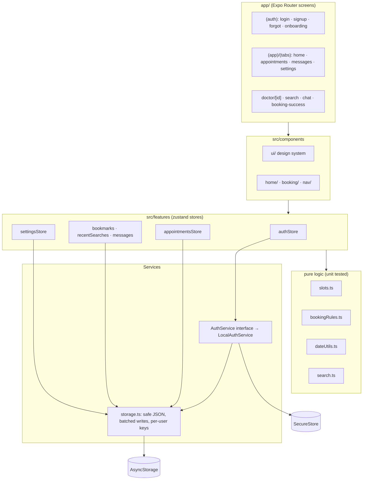

<div align="center">

# MediCare

**A polished, local-first doctor appointment app for Android and iOS.**
Find trusted doctors, book a slot in a few taps, re-schedule with a swipe.


</div>

---

## Screenshots

> Captures go in [`docs/screenshots/`](docs/screenshots/README.md). Replace the placeholders below.

|                Home                |                Doctor & booking                 |                    Confirm                     |                    Appointments                    |
| :--------------------------------: | :---------------------------------------------: | :--------------------------------------------: | :------------------------------------------------: |
|  |  |  |  |

|                 Search                 |                Login                 |                 Sign up                 |                 Settings (dark)                 |
| :------------------------------------: | :----------------------------------: | :-------------------------------------: | :---------------------------------------------: |
|  |  |  |  |

<!-- Optional:  -->

---

## Features

**Booking**

- Doctor detail with a large transparent cut-out portrait, rating chip and bio
- Month navigation, a Sun–Sat day row that swipes by week, past days disabled
- 30-minute slots 8:00–17:00 with a lunch break, realistic seeded availability, live "N Slots" count, paging past 9 slots
- No double booking across doctors, confirmation sheet with notes, success modal with confetti
- Re-schedule (old slot highlighted, same record updated), cancel with a confirm sheet, automatic move to "Past"

**Home**

- Time-aware greeting, bell with a reminder dot that wiggles once
- Stacked "Upcoming appointment" cards you can fling through
- Specialty chips with one sliding selection pill; doctor list re-orders with a layout animation
- Swipe left to bookmark, long-press for quick actions (Book, Profile, Bookmark, Share)

**Accounts (local demo)**

- Sign up / sign in with zod validation, animated strength meter, shake on error
- Salted SHA-256 hashing, Remember me (30 days in SecureStore) or in-memory session
- 5 failed attempts → 30 s lockout with a live countdown
- Forgot password (local demo flow), change password, edit profile with photo, delete account
- Guest mode, per-user data isolation

**Everything else**

- Search with 300 ms debounce, highlighted matches and per-user recent searches
- Local chat with every doctor you booked
- Settings: reminders, haptics, reduce motion, System / Light / Dark theme
- Floating animated tab bar, skeleton shimmer, toasts, friendly empty and error states
- Accessibility: labels and roles everywhere, 44 pt targets, dynamic type to 1.3×, reduced motion

---

## Tech stack

| Area       | Choice                                                                                                                              |
| ---------- | ----------------------------------------------------------------------------------------------------------------------------------- |
| Framework  | Expo SDK 58, React Native 0.88 (New Architecture, Hermes), React 19                                                                 |
| Language   | TypeScript 6, `strict` + `noUncheckedIndexedAccess`                                                                                 |
| Navigation | Expo Router (file-based), route groups, `Stack.Protected` guard, custom JS tab bar                                                  |
| Motion     | react-native-reanimated 4 + react-native-worklets, react-native-gesture-handler 3                                                   |
| State      | zustand 5 + `persist` (version, migrate, partialize, hydration flags)                                                               |
| Forms      | react-hook-form + zod 4                                                                                                             |
| Storage    | AsyncStorage (data), expo-secure-store (session), expo-crypto (hashing)                                                             |
| UI         | expo-image (blurhash, memory-disk cache), expo-linear-gradient, react-native-svg, @expo/vector-icons, @shopify/flash-list v2, Inter |
| Quality    | ESLint (eslint-config-expo + React Compiler rules) + Prettier, Jest (jest-expo)                                                     |
| Assets     | Python pipeline: Pexels photos → rembg cut-outs → WebP + blurhash                                                                   |

---

## Getting started

```bash
npm install
npx expo start          # a = Android, i = iOS
```

All native modules used are part of Expo Go for SDK 58. For installable builds use EAS:
`npx eas-cli@latest build -p android --profile preview`.

| Script                   | Purpose                                               |
| ------------------------ | ----------------------------------------------------- |
| `npm start`              | Expo dev server                                       |
| `npm run typecheck`      | `tsc --noEmit`                                        |
| `npm run lint`           | ESLint, `--max-warnings=0`                            |
| `npm run format`         | Prettier                                              |
| `npm test`               | Jest unit tests                                       |
| `npm run export:android` | Production Android JS bundle (`expo export`)          |
| `npm run images`         | Re-run the photo pipeline (`scripts/fetch-images.py`) |

---

## Architecture



**Principles:** feature folders; screens render and dispatch; rules live in pure functions;
services sit behind interfaces; every persisted store is versioned and migration-safe.

```
app/                      routes: _layout (fonts, splash guard, route guard, ErrorBoundary)
  (auth)/                 login, signup, forgot-password, onboarding
  (app)/(tabs)/           index, appointments, messages, settings
  (app)/                  doctor/[id], search, chat/[doctorId], edit-profile, change-password, booking-success
src/components/ui/        Button, Input, PasswordInput, Chip, CircleButton, Card, Avatar, Skeleton,
                          PressableScale, BottomSheet, ConfirmSheet, SegmentedControl, Toast, EmptyState …
src/components/home/      GreetingHeader, SearchBar, AppointmentStack, AppointmentCard, FilterChips, DoctorCard …
src/components/booking/   DoctorHero, MonthHeader, DateStrip, TimeGrid, BookingSheet, BookButton, Confetti
src/components/nav/       FloatingTabBar
src/features/             auth/, appointments/, doctors/, messages/, settings/, session/
src/theme/                colors (light/dark), typography, spacing, shadows, useTheme
src/utils/                storage, haptics, motion, hooks
scripts/fetch-images.py   dev-time image pipeline
__tests__/                auth, slots, booking rules, search, migrations
```

### Auth and session flow

1. The root layout holds the native splash until fonts, the settings store and `authStore.bootstrap()` finish (6 s safety timeout).
2. `bootstrap()` asks `AuthService.getSession()`. A valid session switches every per-user store to that user and rehydrates it; otherwise the app shows `(auth)`.
3. `Stack.Protected` guards decide which route group is reachable, so there is no flicker.

| Concern          | Implementation                                                                |
| ---------------- | ----------------------------------------------------------------------------- |
| Password storage | random 16-byte salt per user, `SHA-256(salt:password)`, constant-time compare |
| Remember me      | ON → SecureStore `session`, 30 days · OFF → memory only                       |
| Brute force      | 5 consecutive failures → 30 s lock (persisted), generic error message         |
| Logout           | removes the session only                                                      |
| Delete account   | removes the user and every `@medicare/*/{userId}` key                         |

**Swap in a real backend:** implement `AuthService` (REST, Firebase, Supabase), map errors to
`AuthError` codes, and export it from `src/features/auth/authClient.ts`. No screen changes.

### Storage keys

| Data                                                  | Store        | Key                         |
| ----------------------------------------------------- | ------------ | --------------------------- |
| Users                                                 | AsyncStorage | `@medicare/users`           |
| Session                                               | SecureStore  | `session`                   |
| Settings                                              | AsyncStorage | `@medicare/settings`        |
| Appointments / Bookmarks / Messages / Recent searches | AsyncStorage | `@medicare/<name>/{userId}` |

Per-user stores read and write through `createUserScopedStorage`. Switching user flushes pending
writes, resets memory without writing, then rehydrates from the new namespace. Writes are debounced
per key (250 ms) and flushed when the app backgrounds. All parsing is corruption-safe.

### Booking rules

- Slots: FNV-1a(`doctorId|date`) seeds mulberry32, marking ~28 % unavailable, stable across renders
- Past days/times and slots you already booked with any doctor are disabled
- Validation runs again on confirm; re-schedule ignores the appointment being moved
- Ended appointments become `past` on launch, every minute, on foreground and on pull-to-refresh

---

## Testing

```bash
npm test
```

55 tests across 4 suites: the auth service (hashing, uniqueness, remember-me, lockout, password
change and reset, deletion and isolation, guest mode, corrupted storage), slot generation
(hours, lunch gap, determinism, past and booked slots, paging, formats), booking rules and the
appointments store (validation, double booking, reschedule, cancel, auto-past), search, and
persisted-state migrations.

---

## Images and credits

`scripts/fetch-images.py` downloads 8 curated [Pexels License](https://www.pexels.com/license/)
photos, builds 400×400 WebP avatars and transparent rembg cut-outs, computes blurhash
placeholders, writes [`CREDITS.md`](CREDITS.md) and regenerates `src/features/doctors/doctorImages.ts`.
Any missing image falls back to a gradient initials avatar, so a broken image is never shown.
Doctor names and bios are fictional. Details: [`assets/README.md`](assets/README.md).

---

## Assumptions and limitations

- **Local auth is a demo.** Salted SHA-256 is far weaker than a server-side slow KDF (Argon2, bcrypt). No sync, no real reset email.
- Voice search shows a "coming soon" tooltip with the listening animation; push notifications are not wired (reminders appear behind the bell).
- The card-to-detail transition is a measured "flying photo", because Reanimated 4 shared element transitions are still behind a feature flag.
- Chat replies are canned demo answers.
- The profile photo keeps the image picker's file URI; if the OS clears it, the avatar falls back to initials.
- Times are device-local.
- Not yet profiled on a physical mid-range Android device (Perf Monitor check pending).
- `react-dom` is pinned only to satisfy optional web peer dependencies; the app targets Android and iOS, portrait.

---

## License

[MIT](LICENSE). Doctor photos are third-party images under the Pexels License (see [CREDITS.md](CREDITS.md)).
